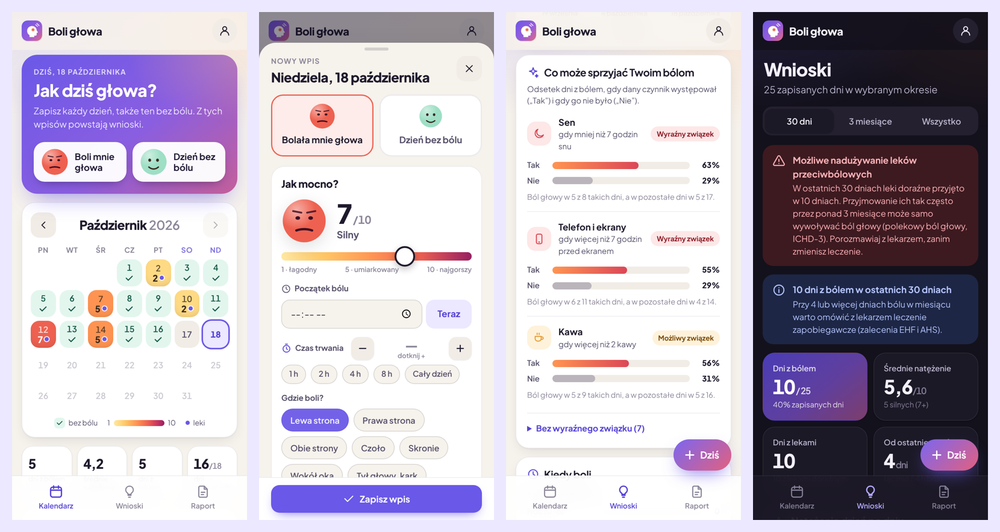

# Boli głowa · dziennik bólu głowy

Prosty dziennik bólu głowy w formie kalendarza. Klikasz dzień i w kilka sekund zapisujesz:

- natężenie bólu w skali 1–10,
- godzinę początku i czas trwania,
- przyjęte leki i to, czy pomogły,
- czas przed telefonem i ekranami,
- kawę, energetyki, sen, wodę, stres, alkohol, ruch i inne możliwe wyzwalacze.

Aplikacja wyciąga z tego wnioski i przygotowuje raport dla lekarza.



## Co potrafi

| | |
|---|---|
| **Kalendarz** | Każdy dzień ma kolor według natężenia bólu (zielony = dzień bez bólu). Kropka oznacza przyjęte leki. Miesiące przewijasz strzałkami albo przesunięciem palca. |
| **Wpis w kilka dotknięć** | Najpierw jedno pytanie: „bolała głowa czy nie?”. Potem suwak natężenia z buźką, przyciski „Teraz” i „1 h / 2 h / 4 h…”, liczniki +/−, a „Jak w poprzednim wpisie” kopiuje nawyki z ostatniego dnia. |
| **Wnioski** | Porównuje odsetek dni z bólem, gdy czynnik występował i gdy go nie było, np. „mniej niż 7 h snu: ból w 63% dni, w pozostałe dni w 29%”. Pokazuje też porę dnia i dzień tygodnia, w których najczęściej boli, skuteczność każdego leku oraz profil bólu (cechy migreny i bólu napięciowego wg ICHD-3). |
| **Alerty zdrowotne** | Ostrzega o możliwym nadużywaniu leków przeciwbólowych (progi ICHD-3), o bólu przez 15 lub więcej dni w miesiącu i o zaznaczonych objawach alarmowych (wtedy wyświetla numer 112). |
| **Raport dla lekarza** | Za 30 dni, 3 miesiące albo cały okres. Można go wydrukować lub zapisać jako PDF, a dane wyeksportować do arkusza CSV (zgodnego z polskim Excelem). |
| **Konto lub tryb bez konta** | Z kontem dane są w Supabase i synchronizują się między urządzeniami. Bez konta zostają w przeglądarce. Wpisy z trybu bez konta można przenieść do konta jednym przyciskiem. Jest też kopia zapasowa do pliku JSON. |
| **Wygoda** | Jasny i ciemny motyw (ciemny jest łagodniejszy przy światłowstręcie). Aplikację można dodać do ekranu głównego telefonu. |

## Na czym opiera się dziennik

- **NICE CG150**, *Headaches in over 12s*: dziennik prowadzony co najmniej 8 tygodni. Zapisuje się częstość, czas trwania i natężenie bólu, objawy towarzyszące, wszystkie przyjęte leki, możliwe wyzwalacze oraz związek z miesiączką.
- **ICHD-3** (International Headache Society):
  - cechy migreny: jednostronny, pulsujący, umiarkowany lub silny ból, który nasila się przy ruchu, z nudnościami albo nadwrażliwością na światło i dźwięk,
  - cechy bólu napięciowego,
  - progi bólu głowy z nadużywania leków: zwykłe leki przeciwbólowe 15 lub więcej dni w miesiącu; tryptany, leki złożone i opioidy 10 lub więcej dni; także 10 lub więcej dni łącznie, gdy łączy się różne grupy leków.
- **European Headache Federation i Lifting The Burden**: wzór dziennika.
- **SNNOOP10** (Do i wsp., *Neurology* 2019): objawy alarmowe.
- **American Headache Society**, konsensus 2021: od kiedy rozważać leczenie zapobiegawcze.

> Aplikacja nie stawia diagnozy i nie zastępuje porady lekarza. Wnioski to zależności statystyczne z Twoich wpisów.

## Uruchomienie

To statyczna strona bez kroku budowania: HTML, CSS i moduły JavaScript. Biblioteka `supabase-js` leży w katalogu `vendor/`.

### GitHub Pages (link na telefon)

1. W repozytorium: **Settings → Pages → Build and deployment → Source: Deploy from a branch**. Wybierz gałąź `main` i folder `/ (root)`, potem **Save**.
2. Po około minucie aplikacja będzie pod adresem `https://fredtestujeai-hash.github.io/Boli-glowa/`.
3. Na telefonie otwórz ten adres i wybierz „Dodaj do ekranu głównego”.

### Supabase (konto i synchronizacja)

Baza działa w projekcie **Klata** (`oxoppwygqxbytzfyrpar`), w osobnej tabeli `public.headache_entries`. Tabele Klaty nie zostały zmienione. Schemat jest w `supabase/migrations/`. Dostęp chroni Row Level Security: zalogowany użytkownik widzi i zmienia wyłącznie własne wpisy, a niezalogowany nie widzi niczego. Adres projektu i klucz publiczny są w `js/config.js`.

Raz trzeba ustawić w panelu Supabase (**Authentication → URL Configuration**):

- **Site URL**: `https://fredtestujeai-hash.github.io/Boli-glowa/`
- **Redirect URLs**: dodaj ten sam adres.

Bez tego link aktywacyjny z e-maila prowadzi na `localhost`. Konto i tak zostanie potwierdzone, ale strona po kliknięciu się nie otworzy.

Jeśli wolisz logować się od razu, bez maila aktywacyjnego, wyłącz **Authentication → Sign In / Providers → Email → Confirm email**.

Wbudowany serwer pocztowy Supabase wysyła tylko kilka maili na godzinę i tylko na adresy członków zespołu projektu. Do użytku przez inne osoby podłącz własny SMTP w **Authentication → Emails → SMTP Settings**.

### Lokalnie

```bash
python3 -m http.server 8080   # albo: npx http-server -p 8080
# otwórz http://localhost:8080
npm test                      # testy logiki wniosków (Node 20+)
```

## Struktura

```
index.html              szkielet aplikacji
css/styles.css          wygląd (jasny i ciemny motyw, druk raportu)
js/app.js               stan, nawigacja, tryby lokalny i chmurowy
js/store.js             zapis: przeglądarka albo Supabase, logowanie
js/entry-model.js       model wpisu i walidacja zgodna z bazą
js/insights.js          analiza: czynniki, progi leków, alerty, profil bólu
js/constants.js         słowniki pól, rozpoznawanie grup leków
js/views/               kalendarz, formularz dnia, wnioski, raport, konto
supabase/migrations/    schemat bazy z RLS
tests/                  testy jednostkowe (node --test)
```
